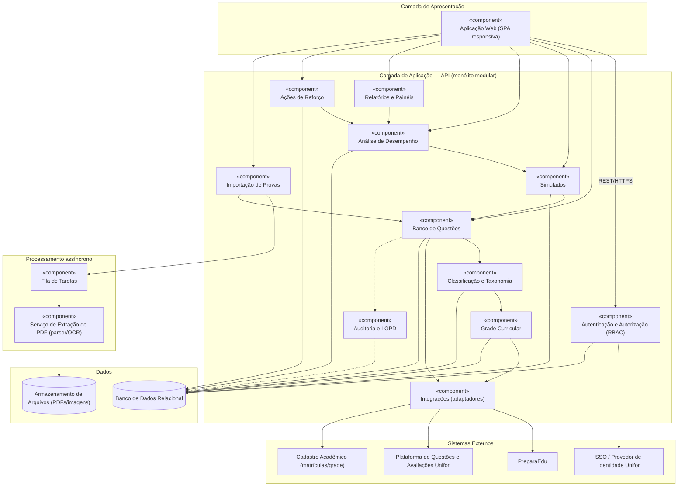
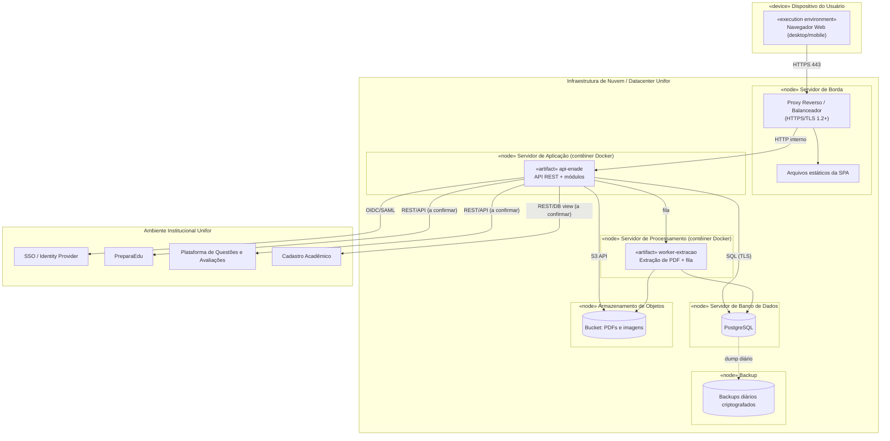

# Plataforma de Gestão do Conhecimento e Aprendizagem — ENADE

**Disciplina:** Requisitos e Modelagem de Sistemas — Unifor (2026.2)
**Entrega:** Sprint 1 · Milestone M1 (20/10/2026 a 02/11/2026)
**Projeto escolhido:** Eixo II — ENADE · Proposta 5 (Plataforma de Gestão do Conhecimento e Aprendizagem — ENADE)
**Grupo:** [nomes e matrículas dos integrantes]

> **Nota de método.** Este documento distingue **informação do material de apoio** (proposta 5), **hipótese** (a validar com stakeholders) e **decisão de escopo**. Nenhum requisito aqui foi validado com stakeholders reais ainda; a coluna/rótulo *Status* indica isso. Os resultados de entrevistas (seção 3) estão como **hipóteses preliminares** até a realização das entrevistas.

## Sumário

1. Documento de Visão
2. Identificação de Stakeholders
3. Roteiro e resultados de entrevistas
4. Requisitos (funcionais e não funcionais)
5. Regras de negócio
6. Backlog priorizado
7. Diagramas UML (casos de uso, componentes, implantação)
8. Premissas, restrições e fontes

---

## 1. Documento de Visão

### 1.1 Justificativa da escolha do problema

O ENADE avalia o desempenho dos concluintes e influencia indicadores institucionais de qualidade dos cursos. As provas anteriores do INEP são um acervo rico, porém ficam em PDFs, sem classificação por tema ou competência e sem relação com a grade curricular. Isso dificulta (a) diagnosticar em quais conteúdos os estudantes têm mais dificuldade e (b) planejar ações de reforço fundamentadas. A proposta 5 foi escolhida porque o problema é bem delimitado, tem valor pedagógico direto, permite definir um produto mínimo viável (banco de questões + simulados + análise) e traz desafios interessantes de levantamento de requisitos (importação de PDFs, direitos de uso, integração institucional).

### 1.2 Problema (declaração)

| Item | Descrição |
|---|---|
| **O problema de** | organizar conteúdos e avaliações do ENADE de forma estruturada, |
| **afeta** | estudantes, docentes, coordenadores de curso/NDE e a gestão acadêmica, |
| **cujo impacto é** | dificuldade em diagnosticar lacunas de aprendizagem, preparo desigual para a prova e ações de reforço pouco direcionadas, |
| **uma solução bem-sucedida seria** | uma plataforma que centralize um banco de questões classificado por temas e competências, relacionado à grade curricular, com simulados e análise de desempenho que apoiem ações de reforço. |

### 1.3 Declaração de posição do produto

| Item | Descrição |
|---|---|
| **Para** | coordenadores, docentes e estudantes da Unifor envolvidos com o ENADE |
| **Que** | precisam diagnosticar dificuldades de aprendizagem e preparar estudantes com base em questões e competências avaliadas |
| **A** | Plataforma de Gestão do Conhecimento e Aprendizagem — ENADE |
| **É um** | sistema web de banco de questões, simulados e análise de desempenho |
| **Que** | importa provas do INEP, classifica questões por tema/competência, relaciona à grade curricular, gera simulados e indicadores de desempenho |
| **Diferente de** | consultar PDFs soltos ou usar planilhas manuais |
| **Nosso produto** | integra conteúdo, avaliação e diagnóstico em um único fluxo, voltado a ações de reforço. *(Relação com PreparaEdu e Plataforma de Questões e Avaliações da Unifor a confirmar — ver 1.8.)* |

### 1.4 Objetivos

**Geral:** apoiar o diagnóstico de dificuldades e a melhoria da aprendizagem dos estudantes por meio da gestão de conteúdos e avaliações do ENADE.

**Específicos:**
- OE1. Centralizar questões (incluindo importação de provas em PDF do INEP) em um banco pesquisável.
- OE2. Classificar questões por tema e competência e relacioná-las à grade curricular.
- OE3. Permitir a montagem e aplicação de simulados.
- OE4. Analisar desempenho individual e coletivo e apontar lacunas.
- OE5. Apoiar o planejamento e o acompanhamento de ações de reforço.

### 1.5 Escopo

**Dentro do escopo do produto mínimo (MVP):**
- Autenticação e perfis (estudante, docente, coordenador, administrador).
- Cadastro manual de questões e importação de provas em PDF com **revisão humana obrigatória**.
- Taxonomia de temas/competências e vínculo com disciplinas da grade.
- Busca e filtros no banco de questões.
- Montagem e resposta de simulados com correção automática.
- Painéis de desempenho individual e por curso/turma; relatórios exportáveis.
- Registro de ações de reforço vinculadas a lacunas identificadas.

**Fora do escopo (nesta fase):**
- Identificação de enadistas/inscrições e estatísticas institucionais do INEP (corresponde à proposta 6).
- Correção de questões discursivas (foco em múltipla escolha; discursivas ficam para evolução futura — *decisão de escopo*).
- Aplicativo móvel nativo (a web será responsiva).
- Recomendação por IA generativa de conteúdos (evolução futura).
- Integrações em produção com PreparaEdu e Plataforma de Questões e Avaliações — nesta fase, apenas **análise de viabilidade e interface prevista** (dependem de autorização e acesso).

### 1.6 Perfis de usuário (resumo)

| Perfil | Necessidade principal |
|---|---|
| Estudante | Praticar com simulados e ver onde está errando |
| Docente | Reaproveitar questões, classificar e montar avaliações |
| Coordenador / NDE | Enxergar lacunas do curso e planejar reforço |
| Administrador | Gerir usuários, integrações e parâmetros |

### 1.7 Funcionalidades de alto nível

F1 Banco de questões · F2 Importação de provas em PDF · F3 Classificação por temas/competências · F4 Vínculo com grade curricular · F5 Simulados · F6 Análise de desempenho · F7 Ações de reforço · F8 Relatórios · F9 Gestão de acesso e auditoria.

### 1.8 Premissas e restrições

**Premissas (a confirmar):**
- P1. Será possível obter acesso a provas do INEP em PDF (são publicadas pelo INEP; **confirmar condições de uso**).
- P2. A Unifor disponibiliza SSO para autenticação.
- P3. Há dados da grade curricular (disciplinas/ementas) em formato aproveitável.
- P4. Haverá coordenadores/docentes disponíveis para entrevistas.

**Restrições:**
- R1. Conformidade com a LGPD (dados de desempenho de estudantes são dados pessoais).
- R2. Direitos de uso das questões devem ser validados antes de publicar o conteúdo.
- R3. Integração com PreparaEdu e Plataforma de Questões depende de autorização e acesso.
- R4. Prazo acadêmico do semestre 2026.2; equipe pequena.
- R5. A qualidade da extração de PDF pode variar (imagens, fórmulas, tabelas) — por isso há revisão humana.

### 1.9 Riscos iniciais

| ID | Risco | Prob. | Impacto | Mitigação |
|---|---|---|---|---|
| RS1 | Extração automática de PDF com baixa qualidade | Alta | Alto | Revisão humana obrigatória; permitir cadastro manual; testar com provas de anos distintos |
| RS2 | Impedimento de direitos de uso das questões | Média | Alto | Registrar fonte/direitos; validar com jurídico/INEP; restringir acesso |
| RS3 | Sem acesso a PreparaEdu/Plataforma de Questões | Média | Médio | Adaptadores desacoplados; MVP independente |
| RS4 | Falta de acesso aos stakeholders para validar | Média | Alto | Agendar entrevistas cedo; usar análise documental; marcar hipóteses |
| RS5 | Exposição de dados pessoais de estudantes | Baixa | Alto | RBAC, minimização, agregação mínima em relatórios coletivos |
| RS6 | Critérios pedagógicos de classificação divergentes | Média | Médio | Taxonomia validada pelo NDE; versionamento da taxonomia |

### 1.10 Glossário

| Termo | Definição |
|---|---|
| ENADE | Exame Nacional de Desempenho dos Estudantes |
| INEP | Instituto Nacional de Estudos e Pesquisas Educacionais Anísio Teixeira |
| Enadista | Estudante habilitado a realizar o ENADE |
| NDE | Núcleo Docente Estruturante |
| Competência | Capacidade que a questão pretende avaliar (conforme matriz/perfil do curso) |
| Tema | Conteúdo/assunto abordado pela questão |
| Banco de questões | Repositório de questões classificadas e versionadas |
| Simulado | Conjunto de questões montado para treino/diagnóstico |
| Lacuna | Tema/competência com desempenho abaixo de um limiar definido |
| Ação de reforço | Intervenção pedagógica planejada para tratar uma lacuna |
| Formação geral / Componente específico | Partes da prova do ENADE |
| PreparaEdu | Plataforma institucional citada no material (relação a investigar) |
| LGPD | Lei Geral de Proteção de Dados (Lei 13.709/2018) |

---

## 2. Identificação de Stakeholders

| ID | Stakeholder | Tipo | Interesse / expectativa | Influência | Como envolver |
|---|---|---|---|---|---|
| S1 | Estudantes (concluintes e demais) | Usuário primário | Treinar, entender erros, melhorar desempenho | Média | Entrevista/questionário, teste de usabilidade |
| S2 | Docentes | Usuário primário | Reutilizar e classificar questões, montar simulados | Alta | Entrevista, validação da taxonomia |
| S3 | Coordenadores de curso | Usuário primário / decisor | Diagnóstico do curso, ações de reforço, relatórios | Alta | Entrevista, validação de painéis |
| S4 | NDE | Especialista pedagógico | Alinhar classificação às competências do curso e à grade | Alta | Oficina de taxonomia |
| S5 | Coordenação/Gestão do ENADE e Avaliação Institucional | Patrocinador / interessado | Melhoria dos indicadores, uso institucional | Alta | Entrevista, apresentação de visão |
| S6 | Equipe de TI / Plataformas institucionais (PreparaEdu, Plataforma de Questões e Avaliações) | Técnico | Integração, segurança, manutenção | Alta | Entrevista técnica, levantamento de APIs |
| S7 | Cadastro acadêmico / Secretaria | Fonte de dados | Fornecer matrículas e grade | Média | Levantamento documental |
| S8 | Encarregado de dados (DPO) / Jurídico | Regulatório | LGPD e direitos de uso de conteúdo | Alta | Consulta formal |
| S9 | INEP | Externo (fonte de provas) | Origem do conteúdo oficial | Baixa (direta) | Análise documental |
| S10 | Professor da disciplina (orientador acadêmico) | Avaliador | Qualidade do processo de requisitos | Alta | Entregas e orientação |
| S11 | Equipe do projeto (grupo) | Desenvolvedor | Entregar o MVP no prazo | — | — |

**Matriz poder × interesse (resumo):** gerenciar de perto → S2, S3, S4, S5, S6, S8; manter informados → S1, S7, S10; monitorar → S9.

---

## 3. Roteiro e resultados de entrevistas

### 3.1 Plano

| ID | Entrevistado (perfil) | Objetivo | Duração | Técnica |
|---|---|---|---|---|
| E1 | Coordenador de curso / NDE | Entender como o ENADE é acompanhado hoje e que decisões precisam de dados | 40 min | Semiestruturada |
| E2 | Docente | Entender como questões são criadas/organizadas e a relação com ementas | 30 min | Semiestruturada |
| E3 | Estudante (concluinte) | Entender como se preparam e o que falta | 25 min | Semiestruturada |
| E4 | TI / responsáveis por PreparaEdu e Plataforma de Questões | Verificar integração, dados, segurança | 30 min | Técnica |
| E5 | DPO / Jurídico | Direitos de uso e LGPD | 20 min | Consulta |

### 3.2 Roteiro por perfil

**Abertura (todos):** apresentar o projeto, informar que a participação é voluntária, pedir autorização para registrar notas/áudio, explicar o uso acadêmico dos dados e que respostas serão anonimizadas no relatório.

**E1 — Coordenador / NDE**
1. Como o curso acompanha o desempenho no ENADE hoje? Que dados utiliza?
2. Que decisões você gostaria de tomar com base em dados de aprendizagem?
3. Quais temas/competências costumam ser críticos? Como são identificados?
4. Como a grade curricular se relaciona com o conteúdo cobrado no ENADE?
5. Quem define e como são conduzidas ações de reforço? Como são acompanhadas?
6. Que indicadores/relatórios seriam indispensáveis? Com que frequência?
7. Quem deve ver resultados individuais e coletivos? Há restrições?
8. Que riscos ou resistências você antevê?

**E2 — Docente**
1. De onde vêm as questões que você usa? Como as organiza hoje?
2. Como você relaciona uma questão a conteúdo/competência? Isso é padronizado?
3. Você usaria provas anteriores do INEP? Que dificuldades encontra?
4. Como monta simulados/avaliações? Que critérios usa (dificuldade, tema, ano)?
5. Que informações precisam existir no cadastro de uma questão?
6. Como gostaria de receber feedback de desempenho da turma?
7. Quanto tempo está disposto a dedicar para revisar questões importadas?

**E3 — Estudante**
1. Como você se prepara para provas amplas como o ENADE?
2. Você já resolveu provas anteriores? Onde as encontra? Que dificuldades teve?
3. Que tipo de feedback ajuda mais (gabarito, explicação, tema fraco)?
4. Prefere simulados cronometrados ou livres? Em que dispositivo?
5. Teria preocupação em ter seu desempenho visto por docentes/coordenação?
6. O que o faria usar (ou abandonar) a plataforma?

**E4 — TI / Plataformas**
1. Qual a relação entre PreparaEdu, Plataforma de Questões e Avaliações e este projeto? Há sobreposição?
2. Existem APIs, exportação ou banco acessível? Quais formatos?
3. Como a autenticação é feita (SSO — OIDC/SAML)? 
4. Existem padrões de infraestrutura, hospedagem e segurança a seguir?
5. Quem mantém o cadastro da grade e das matrículas? Como obter esses dados?
6. Há limites de volume/pico (ex.: simulados simultâneos)?

**E5 — DPO / Jurídico**
1. Que base legal se aplica ao tratamento de desempenho de estudantes?
2. Que restrições há para armazenar/distribuir provas do INEP dentro da instituição?
3. Prazo de retenção e regras de anonimização para relatórios?
4. Há exigência de relatório de impacto (RIPD)?

**Encerramento (todos):** quem mais deveríamos ouvir? Posso retornar para validar os requisitos?

### 3.3 Registro de resultados

**Status das entrevistas:** ☐ E1 ☐ E2 ☐ E3 ☐ E4 ☐ E5 — *a realizar/registrar pelo grupo; marcar data e responsável.*

**Modelo de registro (copiar por entrevista):**

| Campo | Preenchimento |
|---|---|
| Entrevista / data / entrevistador / anotador | |
| Entrevistado (perfil; identificação anonimizada se necessário) | |
| Principais necessidades relatadas | |
| Problemas atuais | |
| Requisitos derivados (IDs) | |
| Regras de negócio mencionadas | |
| Pontos de divergência / dúvidas | |
| Próximos passos | |

### 3.4 Hipóteses preliminares (ainda **não confirmadas**)

Derivadas apenas do texto da proposta 5 e usadas para construir os requisitos da seção 4. Cada uma deve ser confirmada, ajustada ou descartada nas entrevistas.

| ID | Hipótese | Origem | Entrevista que valida | Status |
|---|---|---|---|---|
| H1 | Coordenadores querem identificar temas/competências com pior desempenho para planejar reforço | Proposta 5 (diagnóstico, reforço) | E1 | Não validada |
| H2 | Docentes precisam classificar questões e relacioná-las a disciplinas | Proposta 5 (classificação, grade) | E2 | Não validada |
| H3 | Importar PDFs do INEP economiza tempo, mas exige revisão humana | Proposta 5 (importação, qualidade da extração) | E2, E4 | Não validada |
| H4 | Estudantes valorizam simulados com feedback por tema | Proposta 5 (simulados, análise) | E3 | Não validada |
| H5 | Pode haver sobreposição com PreparaEdu/Plataforma de Questões, exigindo integração ou diferenciação | Proposta 5 (questões para levantamento) | E4 | Não validada |
| H6 | Direitos de uso das questões e LGPD restringem acesso e exibição | Proposta 5 (direitos de uso) | E5 | Não validada |
| H7 | Resultados coletivos devem proteger identidade em grupos pequenos | Boas práticas LGPD | E1, E5 | Não validada |

---

## 4. Requisitos

**Legenda de prioridade (MoSCoW):** M = Must · S = Should · C = Could · W = Won't (nesta fase).
**Status:** *Hipótese* = derivado do material, a validar; *Decisão* = decisão de escopo do grupo.
**Rastreabilidade:** campo "Origem" liga o requisito às hipóteses (H) e aos casos de uso (UC).

### 4.1 Requisitos Funcionais

| ID | Requisito | Prior. | Origem | Status |
|---|---|---|---|---|
| RF01 | O sistema deve autenticar usuários via SSO institucional. | M | UC01, H5 | Hipótese |
| RF02 | O sistema deve controlar acesso por perfis (estudante, docente, coordenador, administrador) com permissões distintas. | M | UC14, H7 | Hipótese |
| RF03 | O sistema deve permitir cadastrar, editar, inativar e consultar questões (enunciado, alternativas, gabarito, imagens, ano/edição, área, fonte). | M | UC02, H2 | Hipótese |
| RF04 | O sistema deve permitir o envio (upload) de provas em PDF do INEP. | M | UC03, H3 | Hipótese |
| RF05 | O sistema deve extrair automaticamente as questões do PDF e apresentá-las como rascunho para revisão. | M | UC03, H3 | Hipótese |
| RF06 | O sistema deve permitir revisar, corrigir, aprovar ou rejeitar cada questão extraída antes de publicá-la no banco. | M | UC04, H3 | Hipótese |
| RF07 | O sistema deve permitir classificar questões por um ou mais temas e competências e pelo componente (formação geral/específico). | M | UC05, H2 | Hipótese |
| RF08 | O sistema deve permitir manter a taxonomia de temas e competências (criar, editar, versionar). | M | UC06, H2 | Hipótese |
| RF09 | O sistema deve relacionar temas/competências a disciplinas da grade curricular do curso. | M | UC06, H2 | Hipótese |
| RF10 | O sistema deve permitir pesquisar e filtrar questões por ano, curso, tema, competência, disciplina, componente e status. | M | UC07 | Hipótese |
| RF11 | O sistema deve permitir montar simulados manualmente ou por critérios (quantidade, temas, competências, ano). | M | UC08, H4 | Hipótese |
| RF12 | O sistema deve permitir que o estudante responda a um simulado, com controle de tempo e de tentativas configuráveis. | M | UC09, H4 | Hipótese |
| RF13 | O sistema deve corrigir automaticamente o simulado e exibir resultado e gabarito. | M | UC09, UC10, H4 | Hipótese |
| RF14 | O sistema deve exibir ao estudante o desempenho individual por tema e competência e a evolução ao longo do tempo. | M | UC10, H4 | Hipótese |
| RF15 | O sistema deve exibir ao docente e ao coordenador o desempenho agregado por curso, turma, tema e competência. | M | UC11, H1 | Hipótese |
| RF16 | O sistema deve identificar lacunas (temas/competências abaixo de limiar configurável). | S | UC11, H1 | Hipótese |
| RF17 | O sistema deve permitir registrar e acompanhar ações de reforço vinculadas a uma lacuna (responsável, prazo, situação). | S | UC12, H1 | Hipótese |
| RF18 | O sistema deve gerar relatórios exportáveis (PDF e CSV) de desempenho e de banco de questões. | S | UC13, H1 | Hipótese |
| RF19 | O sistema deve registrar fonte e situação de direitos de uso de cada questão. | M | UC02, UC04, H6 | Hipótese |
| RF20 | O sistema deve manter histórico de versões das questões e trilha de auditoria de ações relevantes. | S | H6 | Hipótese |
| RF21 | O sistema deve permitir marcar questões anuladas/ajustadas oficialmente e excluí-las do cálculo de desempenho. | S | H3 | Hipótese |
| RF22 | O sistema deve prever adaptadores para importar/exportar dados de PreparaEdu e da Plataforma de Questões e Avaliações da Unifor. | C | UC15, H5 | Hipótese |
| RF23 | O sistema deve permitir ao administrador gerenciar usuários, cursos e parâmetros (limiar de lacuna, tentativas, tempo). | S | UC14 | Decisão |

### 4.2 Requisitos Não Funcionais

| ID | Categoria | Requisito | Métrica / critério de aceitação | Prior. |
|---|---|---|---|---|
| RNF01 | Desempenho | Telas de consulta e painéis devem responder rapidamente em uso normal. | ≥ 95% das requisições em ≤ 3 s com 200 usuários simultâneos *(valor inicial a validar)* | M |
| RNF02 | Desempenho | O processamento de importação de PDF deve ocorrer de forma assíncrona, sem bloquear o usuário. | Progresso visível; prova de ~90 questões processada em ≤ 10 min *(a validar)* | S |
| RNF03 | Escalabilidade | O sistema deve suportar picos de simulados simultâneos. | 500 sessões simultâneas sem perda de respostas *(a validar com E4)* | S |
| RNF04 | Disponibilidade | O sistema deve ficar disponível em horário de uso acadêmico. | ≥ 99% mensal em horário 7h–23h *(a validar)* | S |
| RNF05 | Segurança | Comunicação criptografada e proteção contra falhas comuns (OWASP Top 10). | TLS 1.2+; sem vulnerabilidades críticas em análise estática/testes | M |
| RNF06 | Segurança | Autorização baseada em perfis (princípio do menor privilégio). | Testes de acesso negado por perfil passam em 100% dos casos | M |
| RNF07 | Privacidade (LGPD) | Dados pessoais e de desempenho tratados com base legal, minimização e retenção definida. | Política aprovada pelo DPO; registro de operações de tratamento | M |
| RNF08 | Privacidade | Relatórios coletivos não devem permitir identificar indivíduos em grupos pequenos. | Agregação mínima de N respondentes (N inicial = 5, a validar) | M |
| RNF09 | Usabilidade | Interface simples para usuários não técnicos. | ≥ 80% de êxito de tarefas-chave em teste com 5 usuários | M |
| RNF10 | Acessibilidade | Conformidade com WCAG 2.1 nível AA. | Verificação automatizada e manual das telas principais | S |
| RNF11 | Compatibilidade | Funcionar em navegadores atuais e dispositivos móveis (layout responsivo). | Chrome, Edge, Firefox e Safari — duas últimas versões | M |
| RNF12 | Confiabilidade | Backup e recuperação de dados. | Backup diário; RPO ≤ 24 h; RTO ≤ 4 h *(a validar)* | S |
| RNF13 | Integridade | Respostas de simulado não podem ser perdidas ou alteradas indevidamente. | Gravação transacional; log de auditoria | M |
| RNF14 | Auditabilidade | Ações críticas devem ser rastreáveis. | Log com usuário, data/hora, ação e objeto | S |
| RNF15 | Manutenibilidade | Código modular, testado e documentado. | Cobertura de testes ≥ 70% nos módulos de negócio; documentação da API | S |
| RNF16 | Interoperabilidade | Integrações via padrões abertos. | OIDC/SAML para login; API REST com JSON | S |
| RNF17 | Qualidade da extração | A importação deve alcançar acurácia mínima antes da revisão. | ≥ 85% das questões extraídas com enunciado e alternativas corretos em amostra de provas *(hipótese; medir)* | S |
| RNF18 | Portabilidade | Implantação em contêineres. | Ambiente reproduzível com Docker | C |

---

## 5. Regras de negócio

| ID | Regra | Relacionados |
|---|---|---|
| RN01 | Somente questões com status **Aprovada** podem ser usadas em simulados e entrar em cálculos de desempenho. | RF06, RF11 |
| RN02 | Questões importadas de PDF são criadas com status **Rascunho** e só mudam de status após revisão humana. | RF05, RF06 |
| RN03 | Toda questão aprovada deve ter: enunciado, alternativas, gabarito, ao menos um tema, ao menos uma competência, componente (geral/específico) e fonte. | RF03, RF07, RF19 |
| RN04 | Toda questão deve ter fonte registrada (ex.: INEP, ano/edição ou autoria docente) e situação de direitos de uso. Questões com direitos não confirmados não podem ser exibidas fora do ambiente autenticado. | RF19 |
| RN05 | O estudante só pode ver seus próprios resultados individuais. | RF14, RF02 |
| RN06 | O coordenador visualiza dados apenas dos cursos sob sua responsabilidade; o docente, das turmas/disciplinas que leciona. | RF15, RF02 |
| RN07 | Relatórios e painéis coletivos só exibem agregados com no mínimo **N respondentes** (valor inicial N = 5). | RF15, RNF08 |
| RN08 | A pontuação de um simulado é: nº de acertos ÷ nº de questões válidas × 100. Questões anuladas oficialmente são desconsideradas. | RF13, RF21 |
| RN09 | A edição de uma questão já usada em simulado aplicado gera **nova versão**; resultados anteriores permanecem associados à versão original. | RF20 |
| RN10 | Um simulado só pode ser aplicado se tiver ao menos uma questão e período de disponibilidade definido; tempo e nº de tentativas são definidos na criação. | RF11, RF12 |
| RN11 | Uma lacuna é caracterizada quando o percentual de acerto em um tema/competência ficar abaixo do limiar configurável (valor inicial 50%, a validar com o NDE), com mínimo de respostas definido. | RF16 |
| RN12 | Toda ação de reforço deve estar vinculada a uma lacuna, ter responsável, prazo e situação (planejada, em andamento, concluída, cancelada). | RF17 |
| RN13 | A taxonomia de temas/competências só pode ser alterada por coordenador/NDE ou administrador; mudanças geram nova versão e não apagam classificações históricas. | RF08 |
| RN14 | Os temas/competências devem estar associados a pelo menos uma disciplina da grade vigente do curso, quando aplicável. | RF09 |
| RN15 | O uso de dados pessoais deve respeitar base legal e finalidade educacional; dados de desempenho não são compartilhados com terceiros externos. | RNF07 |
| RN16 | Questões anuladas ou alteradas oficialmente pelo INEP devem ser sinalizadas; a anulação afeta apenas cálculos futuros ou recalculados conforme decisão do coordenador. | RF21 |
| RN17 | Só administradores podem desativar usuários; inativação preserva o histórico de resultados conforme a política de retenção. | RF23, RNF07 |
| RN18 | Todas as ações de aprovação, publicação, exclusão e alteração de taxonomia devem ser registradas em auditoria. | RF20, RNF14 |

> **Pendente de validação:** valores de N (RN07), limiar de lacuna (RN11), política de retenção (RN17) e se a anulação recalcula resultados passados (RN16).

---

## 6. Backlog priorizado

**Critérios de priorização:** valor para o diagnóstico/aprendizagem (V), dependência técnica (D) e risco (R). Estimativa em pontos de história (escala de Fibonacci). Ordem = ordem de execução sugerida.

**Épicos:** E1 Acesso e Perfis · E2 Banco de Questões · E3 Importação de Provas · E4 Classificação e Grade · E5 Simulados · E6 Análise de Desempenho · E7 Reforço e Relatórios · E8 Integrações e Governança.

| # | ID | História de usuário | Épico | RF/RN | Prior. | Pts | Sprint alvo |
|---|---|---|---|---|---|---|---|
| 1 | US01 | Como usuário, quero entrar com minha conta institucional para acessar a plataforma com segurança. | E1 | RF01, RNF05 | Must | 5 | S2 |
| 2 | US02 | Como administrador, quero atribuir perfis e permissões para controlar o que cada usuário vê. | E1 | RF02, RF23, RN05–06 | Must | 5 | S2 |
| 3 | US03 | Como docente, quero cadastrar uma questão com gabarito e fonte para alimentar o banco. | E2 | RF03, RF19, RN03–04 | Must | 5 | S2 |
| 4 | US04 | Como coordenador, quero manter a taxonomia de temas e competências para padronizar a classificação. | E4 | RF08, RN13 | Must | 5 | S2 |
| 5 | US05 | Como coordenador, quero relacionar temas/competências às disciplinas da grade para ligar o ENADE ao currículo. | E4 | RF09, RN14 | Must | 5 | S2 |
| 6 | US06 | Como docente, quero classificar uma questão por tema e competência para permitir análises. | E4 | RF07, RN03 | Must | 3 | S2 |
| 7 | US07 | Como docente, quero pesquisar e filtrar questões para reaproveitá-las. | E2 | RF10 | Must | 5 | S2 |
| 8 | US08 | Como coordenador, quero enviar uma prova em PDF do INEP para iniciar a importação. | E3 | RF04 | Must | 3 | S3 |
| 9 | US09 | Como coordenador, quero que as questões do PDF sejam extraídas como rascunho para economizar digitação. | E3 | RF05, RN02, RNF17 | Must | 13 | S3 |
| 10 | US10 | Como revisor, quero corrigir e aprovar/rejeitar questões extraídas para garantir a qualidade do banco. | E3 | RF06, RN01–02 | Must | 8 | S3 |
| 11 | US11 | Como docente, quero montar um simulado por critérios para treinar competências específicas. | E5 | RF11, RN10 | Must | 8 | S3 |
| 12 | US12 | Como estudante, quero responder a um simulado com tempo controlado para me preparar. | E5 | RF12, RN10, RNF13 | Must | 8 | S3 |
| 13 | US13 | Como estudante, quero ver minha nota e o gabarito ao finalizar para aprender com os erros. | E5 | RF13, RN08 | Must | 5 | S3 |
| 14 | US14 | Como estudante, quero ver meu desempenho por tema e competência para saber onde melhorar. | E6 | RF14, RN05 | Must | 8 | S4 |
| 15 | US15 | Como coordenador, quero ver o desempenho do curso/turma por tema para diagnosticar dificuldades. | E6 | RF15, RN06–07 | Must | 8 | S4 |
| 16 | US16 | Como coordenador, quero identificar lacunas automaticamente para priorizar ações. | E6 | RF16, RN11 | Should | 5 | S4 |
| 17 | US17 | Como coordenador, quero registrar e acompanhar ações de reforço para tratar lacunas. | E7 | RF17, RN12 | Should | 8 | S4 |
| 18 | US18 | Como coordenador, quero exportar relatórios em PDF/CSV para apresentar ao NDE. | E7 | RF18 | Should | 5 | S4 |
| 19 | US19 | Como gestor, quero histórico de versões e auditoria para rastrear alterações de questões. | E8 | RF20, RN09, RN18 | Should | 8 | S5 |
| 20 | US20 | Como coordenador, quero marcar questões anuladas para que não distorçam resultados. | E6 | RF21, RN16 | Should | 3 | S5 |
| 21 | US21 | Como administrador, quero configurar parâmetros (limiar, tentativas, tempo) para adaptar a plataforma. | E8 | RF23 | Should | 3 | S5 |
| 22 | US22 | Como equipe de TI, quero adaptadores para PreparaEdu/Plataforma de Questões para evitar retrabalho. | E8 | RF22 | Could | 13 | S5+ |
| 23 | US23 | Como pessoa com deficiência, quero uma interface acessível para usar a plataforma. | Transversal | RNF10 | Should | 5 | Contínuo |
| 24 | US24 | Como DPO, quero política de retenção e anonimização aplicada para cumprir a LGPD. | E8 | RN15, RN17, RNF07 | Must | 5 | S2–S3 |
| — | — | Correção de questões discursivas; recomendação por IA; app móvel nativo; módulo de inscrições/estatísticas INEP (proposta 6). | — | — | Won't (agora) | — | — |

**Sprint 1 (esta entrega):** elicitação, requisitos, modelagem inicial (itens 1–7 do backlog e a validação com stakeholders compõem o ponto de partida da Sprint 2).

**Definition of Ready:** história com critério de aceitação, requisitos/RN associados e estimativa.
**Definition of Done:** código revisado, testes passando, critérios de aceitação atendidos, documentação atualizada.

### Critérios de aceitação de exemplo (histórias de maior risco)

**US09 — Extração de PDF**
- Dado um PDF válido de prova do INEP, quando o coordenador envia o arquivo, então o sistema cria questões em *Rascunho* com enunciado e alternativas separados.
- Dado um PDF com imagens/fórmulas, então o sistema preserva as imagens associadas e sinaliza itens com baixa confiança para revisão.
- Dado um PDF ilegível, então o sistema informa o erro e não cria questões.

**US15 — Desempenho coletivo**
- Dado um grupo com menos de N respondentes, então o sistema oculta o agregado e informa a restrição.
- Dado um coordenador de outro curso, então o acesso é negado.

---

## 7. Diagramas UML

Os diagramas estão em `diagramas/` (imagens PNG + código-fonte) e reproduzidos abaixo. Casos de uso foram desenhados com Graphviz; componentes e implantação em Mermaid (renderizam direto no GitHub).

### 7.1 Diagrama de Casos de Uso

**Atores:** Estudante, Docente, Coordenador de Curso/NDE, Administrador (primários); SSO Unifor, PreparaEdu/Plataforma de Questões (sistemas externos).

| UC | Nome | Ator principal | Requisitos |
|---|---|---|---|
| UC01 | Autenticar-se | Todos | RF01 |
| UC02 | Cadastrar questão | Docente | RF03, RF19 |
| UC03 | Importar prova INEP em PDF | Coordenador | RF04, RF05 |
| UC04 | Revisar questões extraídas | Coordenador/Docente | RF06 |
| UC05 | Classificar questão por tema/competência | Docente | RF07 |
| UC06 | Gerenciar taxonomia e grade | Coordenador/Admin | RF08, RF09 |
| UC07 | Pesquisar no banco de questões | Docente | RF10 |
| UC08 | Montar simulado | Docente/Coordenador | RF11 |
| UC09 | Responder simulado | Estudante | RF12, RF13 |
| UC10 | Consultar desempenho individual | Estudante | RF14 |
| UC11 | Analisar desempenho do curso/turma | Docente/Coordenador | RF15, RF16 |
| UC12 | Planejar ação de reforço | Coordenador | RF17 |
| UC13 | Emitir relatório | Coordenador | RF18 |
| UC14 | Gerenciar usuários e permissões | Administrador | RF02, RF23 |
| UC15 | Sincronizar com plataformas institucionais | Administrador | RF22 |

**Especificação resumida de caso de uso crítico — UC03 Importar prova INEP em PDF**

| Campo | Descrição |
|---|---|
| Ator principal | Coordenador de Curso |
| Pré-condições | Usuário autenticado com permissão de importação |
| Fluxo principal | 1) Informar ano/edição/área e enviar o PDF. 2) Sistema valida o arquivo e enfileira o processamento. 3) Sistema extrai as questões e cria rascunhos. 4) Sistema notifica o término. 5) Inclui UC04 (Revisar questões extraídas). |
| Fluxos alternativos | A1) Arquivo inválido/ilegível: sistema recusa e informa motivo. A2) Questão com baixa confiança: sistema marca para revisão obrigatória. |
| Pós-condições | Questões em *Rascunho* associadas à prova de origem |
| Regras | RN02, RN04 |

### 7.2 Diagrama de Componentes

| Componente | Responsabilidade | Requisitos |
|---|---|---|
| Aplicação Web | Interface responsiva para os quatro perfis | RNF09–11 |
| Autenticação e Autorização | Login via SSO, perfis e permissões | RF01, RF02 |
| Banco de Questões | CRUD, status, versões e busca de questões | RF03, RF10, RF19, RF20 |
| Importação de Provas | Upload, orquestração e criação de rascunhos | RF04, RF05, RF06 |
| Serviço de Extração de PDF | Parser/OCR de provas | RF05, RNF17 |
| Classificação e Taxonomia | Temas, competências e classificação | RF07, RF08 |
| Grade Curricular | Disciplinas e vínculos | RF09 |
| Simulados | Montagem, aplicação e correção | RF11–13 |
| Análise de Desempenho | Indicadores, lacunas | RF14–16 |
| Ações de Reforço | Planejamento e acompanhamento | RF17 |
| Relatórios e Painéis | Exportação e visualização | RF18 |
| Integrações | Adaptadores para sistemas institucionais | RF22 |
| Auditoria e LGPD | Logs, anonimização/agregação | RF20, RNF07–08, RNF14 |

*Decisão arquitetural preliminar:* monólito modular com worker assíncrono para a extração — adequado ao tamanho da equipe e ao prazo; módulos desacoplados facilitam futura separação.

### 7.3 Diagrama de Implantação

*Tecnologias (PostgreSQL, Docker, S3-compatível) são **sugestões iniciais** e podem mudar conforme os padrões da TI da Unifor (E4).*

### 7.4 Rastreabilidade (visão resumida)

| Objetivo | Casos de uso | Requisitos | Componentes |
|---|---|---|---|
| OE1 Banco centralizado | UC02, UC03, UC04, UC07 | RF03–RF06, RF10 | Banco de Questões, Importação, Extração |
| OE2 Classificação e grade | UC05, UC06 | RF07–RF09 | Classificação, Grade |
| OE3 Simulados | UC08, UC09 | RF11–RF13 | Simulados |
| OE4 Análise de desempenho | UC10, UC11 | RF14–RF16 | Análise de Desempenho |
| OE5 Reforço | UC12, UC13 | RF17, RF18 | Ações de Reforço, Relatórios |

---

## 8. Premissas, restrições, decisões e fontes

**Fonte principal:** documento *Propostas de Projetos de Sistemas — Internacionalização e ENADE* (Unifor, material didático 2026.2), **proposta 5**: problema a investigar, escopo inicial sugerido e questões para levantamento.

**Decisões de escopo registradas:**
- D1. Escolha da proposta 5 (Eixo II — ENADE); a proposta 6 fica fora.
- D2. MVP centrado em múltipla escolha; discursivas ficam para evolução.
- D3. Importação de PDF sempre com revisão humana.
- D4. Integração com PreparaEdu e Plataforma de Questões tratada como possibilidade (RF22 = Could) até confirmação em E4.
- D5. Aplicação web responsiva; sem app nativo.

**Pontos em aberto (levar às entrevistas):**
1. Qual a relação funcional com PreparaEdu e com a Plataforma de Questões e Avaliações da Unifor (complemento, substituição ou integração)? *(E4)*
2. Quais são os direitos/condições de uso das provas do INEP dentro da plataforma? *(E5)*
3. Quais critérios pedagógicos e matriz de competências devem orientar a classificação? *(E1, E4 NDE)*
4. Quais cursos entram no MVP? *(E1)*
5. Valores de N, limiar de lacuna e retenção de dados. *(E1, E5)*
6. Fonte e formato da grade curricular. *(E4, S7)*

**Próximos passos (Sprint 2):** realizar entrevistas E1–E5 e registrar resultados na seção 3.3; validar RF/RNF/RN com stakeholders; refinar UC e diagramas; iniciar histórias US01–US07.
